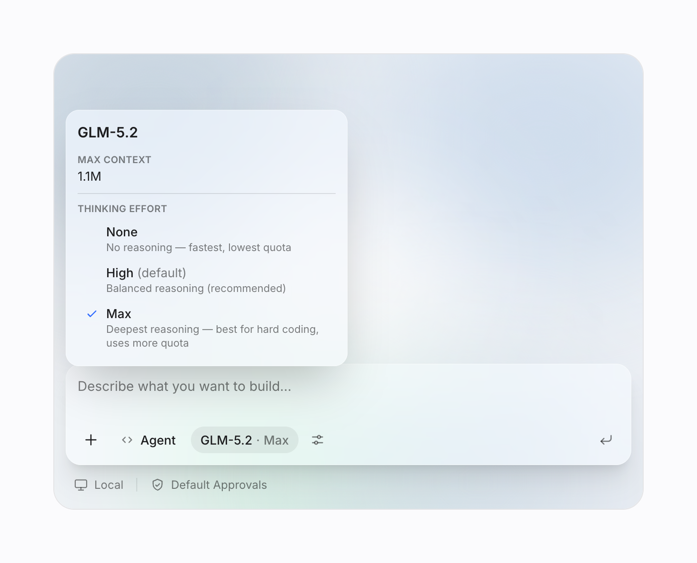
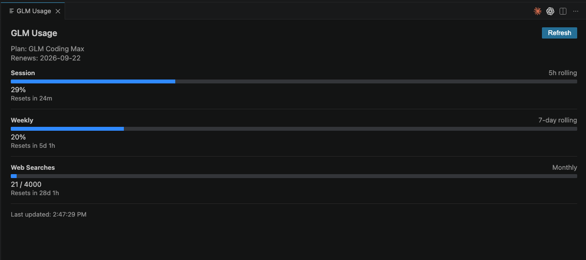

# GLM Models for GitHub Copilot Chat

[](https://marketplace.visualstudio.com/items?itemName=yijiazhen-qi.glm-for-github-copilot-chat)
[](https://marketplace.visualstudio.com/items?itemName=yijiazhen-qi.glm-for-github-copilot-chat)
[](https://marketplace.visualstudio.com/items?itemName=yijiazhen-qi.glm-for-github-copilot-chat)
[](https://github.com/KiwiGaze/glm-for-copilot/actions/workflows/ci.yml)
[](LICENSE.txt)

<p align="center">
  
</p>

Use GLM models in GitHub Copilot Chat with your own API key. The extension adds GLM-5.3, GLM-5.3-Flash, and GLM-5.3-FlashX to the model picker and supports image input, agent mode, tool calling, and thinking. GLM-5.2 and earlier are available in settings.

> This is an unofficial extension with no affiliation, endorsement, or sponsorship from Zhipu AI, Z.AI, GitHub, or Microsoft. "GLM", "Copilot", and "Visual Studio Code" are trademarks of their respective owners. You supply the API key and pay for GLM usage.

## Features

- GLM-5.3 and both Flash models have 1M-token context windows. Thinking streams into Copilot's thinking UI. The Thinking Effort control offers Low / High / Max, defaults to Max, and keeps thinking enabled. You can switch models during a conversation and keep its history.
- Use a GLM Coding Plan subscription or the pay-as-you-go Standard API in either the International (`z.ai`) or Mainland China (`bigmodel.cn`) region. GLM-5.3 is Coding Plan only; FlashX is Standard API only. Flash is available on both. See [Coding Plan vs Standard API](#coding-plan-vs-standard-api).
- Check usage in the status bar or with `GLM: Show Usage Details`. Coding Plan shows session (5-hour) and weekly (7-day) token limits, monthly web searches, and reset countdowns. Standard API shows cash balance and token packages. The status bar turns red when quota reaches 100% or balance reaches 0. Both regions are supported when no custom `baseUrl` is set.

<p align="center">
  
</p>

- Store your key with `GLM: Set API Key`, which uses VS Code `SecretStorage` (the OS keychain on macOS, Windows, and Linux). A settings fallback exists for CI or automation. Keep real keys out of workspace settings.
- Add other GLM models through [`glm-copilot.customModels`](#settings), including models served by a proxy or custom endpoint.
- Paste images into chat. Flash and FlashX accept them directly; text-only models receive a description from Flash. See [Image input](#image-input).

The extension uses the VS Code Language Model Provider API and Node.js built-ins. It has no runtime dependencies.

## Getting started

### Prerequisites

- VS Code 1.127 or later
- An active GitHub Copilot subscription (Free, Pro, or Enterprise)
- A GLM API key from [z.ai](https://z.ai/manage-apikey/apikey-list) or [bigmodel.cn](https://open.bigmodel.cn/usercenter/proj-mgmt/apikeys), or a GLM Coding Plan subscription

### Installation

Install from the [VS Code Marketplace](https://marketplace.visualstudio.com/items?itemName=yijiazhen-qi.glm-for-github-copilot-chat), or search "GLM Models for GitHub Copilot Chat" in the Extensions panel (`Cmd/Ctrl + Shift + X`):

```bash
code --install-extension yijiazhen-qi.glm-for-github-copilot-chat
```

If you have the old Marketplace extension installed, uninstall it first. The old and new IDs can both register the same `glm-copilot.*` commands and settings:

```bash
code --uninstall-extension YijiazhenQi.glm-for-copilot-chat
code --install-extension yijiazhen-qi.glm-for-github-copilot-chat
```

### Usage

1. `GLM: Set API Key` (Command Palette, `Cmd/Ctrl + Shift + P`) → paste your key. GLM key format is `{id}.{secret}`.
2. (Optional) `GLM: Open Settings` to choose your API mode and region.
3. Open Copilot Chat and start with GLM-5.3, or pick another available GLM model.

Use `GLM: Set API Key` or `GLM: Clear API Key` to update or remove the key later.

## Models

| Model | Model type | Context | Max output | Available on official endpoints | Images | Tools | Thinking |
|---|---|---|---|---|---|---|---|
| GLM-5.3 | Default coding model | 1M | 128K | Coding Plan only | Via Flash | Yes | Always on (Low / High / Max) |
| GLM-5.3-Flash | Multimodal | 1M | 128K | Coding Plan + Standard | Native | Yes | Always on (Low / High / Max) |
| GLM-5.3-FlashX | Multimodal | 1M | 128K | Standard only | Native | Yes | Always on (Low / High / Max) |
| GLM-5.2 | Legacy | 1M | 128K | Coding Plan + Standard | Via Flash | Yes | Yes (effort) |
| GLM-5.1 | Legacy | 200K | 128K | Standard only | Via Flash | Yes | Yes |
| GLM-5 | Legacy | 200K | 128K | Standard only | Via Flash | Yes | Yes |
| GLM-4.7 | Legacy | 200K | 128K | Coding Plan + Standard | Via Flash | Yes | Yes |
| GLM-4.5 Air | Legacy | 128K | 96K | Coding Plan + Standard | Via Flash | Yes | Yes |

New installations show the current models: GLM-5.3 and GLM-5.3-Flash on Coding Plan, or GLM-5.3-Flash and GLM-5.3-FlashX on Standard API. GLM-5.2 and earlier are available through `glm-copilot.showLegacyModels`. Existing installations retain legacy access on upgrade so saved conversations can still use those models. Turning the setting off can make an old conversation's model unavailable. Explicit `customModels` remain visible, including older models.

GLM recommends GLM-5.3 for Coding Plan and GLM-5.3-Flash for Standard API in new Chat and Copilot CLI conversations. An explicit user or organization `chat.defaultModel` setting takes precedence. If no explicit default exists and the extension's built-in default does not match your API mode, GLM sets the matching default in workspace settings, or user settings in an empty window. It updates defaults it wrote when API mode changes; editing the setting yourself stops those updates. Existing conversations keep their selected model.

Run `GLM: Use Recommended Default Model` to replace an old default and follow recommendations for the current API mode. It writes to workspace settings when a workspace is open, otherwise user settings. Start a new conversation to use the default. The host controls the picker layout, recent models, and saved selections.

A custom `baseUrl` skips the official API-mode availability filter, but still respects the legacy-model setting. Custom models replace built-ins with the same id. For custom endpoints or custom definitions replacing the recommended model, choose a model manually; the extension cannot infer availability and does not update the default.

## Settings

| Setting | Default | Description |
|---|---|---|
| `glm-copilot.apiMode` | `coding-plan` | Which GLM API to use: `coding-plan` or `standard`. See below. |
| `glm-copilot.region` | `international` | Server region for both chat API modes and Flash image analysis: `international` (z.ai) or `china` (bigmodel.cn). A custom `baseUrl` overrides it for all model requests. |
| `glm-copilot.baseUrl` | *(empty)* | Override the GLM API base URL for chat and Flash image analysis. Overrides `apiMode` and `region` and skips official API-mode model filtering. Images use this endpoint too. |
| `glm-copilot.maxTokens` | `0` | Maximum output tokens per request. `0` means no explicit limit (uses API default). |
| `glm-copilot.maxRetries` | `3` | Automatic retries for transient chat failures (HTTP `429`/`5xx`), not counting the first attempt. `0` disables retries (fail fast). Range 0–10. Backoff honors the server's `Retry-After`. |
| `glm-copilot.thinking` | `enabled` | Enable or disable reasoning for models without a per-model Thinking Effort picker. GLM-5.2 uses None / High / Max; GLM-5.3, Flash, and FlashX require thinking and use Low / High / Max, defaulting to Max. |
| `glm-copilot.visionPrompt` | *(empty)* | Instruction sent to GLM-5.3-Flash when a text-only model needs image analysis. Empty uses the built-in neutral description prompt. Changing it invalidates the in-memory analysis cache. |
| `glm-copilot.showLegacyModels` | `false` | Show GLM-5.2 and earlier. Existing installations retain access on upgrade. |
| `glm-copilot.customModels` | `[]` | Add your own models. Array of model id strings or objects: `{ id, name?, maxInputTokens?, maxOutputTokens?, toolCalling?, thinking?, nativeImageInput? }`. `nativeImageInput` defaults to `false`. |
| `glm-copilot.modelIdOverrides` | `{}` | Remap a built-in model's API id (keys = picker id, values = id sent to the API). Use for regional endpoints or proxies with different names. |
| `glm-copilot.debugLogging` | `false` | Write verbose debug logs to the GLM output channel. View with `GLM: Show Logs`. |
| `glm-copilot.usageRefreshIntervalMinutes` | `5` | How often (in minutes) to refresh the GLM usage status bar. Minimum `1`. Shows Coding Plan quota or Standard API balance for both `z.ai` and `bigmodel.cn` regions. Only when no `baseUrl` override. |
| `glm-copilot.showUsageStatusBar` | `true` | Show the GLM usage status-bar item. Coding Plan quota or Standard API balance, both `z.ai` and `bigmodel.cn` regions. Only when no `baseUrl` override. |

## Coding Plan vs Standard API

Coding Plan uses a GLM Coding Plan subscription. Standard API charges by usage through the GLM Open Platform. Both use the endpoint for your selected `region`.

If the Usage panel cannot find usable Coding Plan quota for the current key, or the session/weekly token quota is exhausted, it offers `Check Standard API`. The extension checks the current key's Standard balance only after you click that action. A positive cash or token-package balance opens a pay-as-you-go confirmation; only `Switch to Standard API` changes `glm-copilot.apiMode`. Dismissing the confirmation or receiving an unavailable, unauthorized, empty, or zero balance changes neither the mode nor the stored key. The model picker then refreshes for Standard availability without selecting a replacement model automatically. Monthly web-search exhaustion alone does not offer this recovery, and it is unavailable with a custom `baseUrl`.

| Mode | Region | Endpoint | Get a key |
|---|---|---|---|
| Coding Plan | International | `https://api.z.ai/api/coding/paas/v4` | [z.ai/manage-apikey/subscription](https://z.ai/manage-apikey/subscription) |
| Coding Plan | Mainland China | `https://open.bigmodel.cn/api/coding/paas/v4` | [bigmodel.cn/coding-plan](https://bigmodel.cn/coding-plan/personal/overview) |
| Standard | International | `https://api.z.ai/api/paas/v4` | [z.ai/manage-apikey/apikey-list](https://z.ai/manage-apikey/apikey-list) |
| Standard | Mainland China | `https://open.bigmodel.cn/api/paas/v4` | [open.bigmodel.cn](https://open.bigmodel.cn/usercenter/proj-mgmt/apikeys) |

Full API documentation: [docs.z.ai](https://docs.z.ai).

GLM-5.3 is documented for Coding Plan on both the [Z.AI](https://docs.z.ai/devpack/latest-model) and [BigModel](https://docs.bigmodel.cn/cn/coding-plan/latest-model.md) endpoints. The current [Z.AI Standard API pricing catalog](https://docs.z.ai/guides/overview/pricing.md) does not include it. BigModel's [model overview](https://docs.bigmodel.cn/cn/guide/start/model-overview.md) lists GLM-5.3, but its [model page](https://docs.bigmodel.cn/cn/guide/models/text/glm-5.3) says the model API is not yet available. This extension therefore does not expose GLM-5.3 on the official Standard endpoints yet; a compatible custom `baseUrl` may serve it.

GLM-5.3-Flash is documented for Coding Plan and Standard use by both [Z.AI](https://docs.z.ai/guides/vlm/glm-5.3-flash) and [BigModel](https://docs.bigmodel.cn/cn/guide/models/vlm/glm-5.3-flash/).

The same [Z.AI model documentation](https://docs.z.ai/guides/vlm/glm-5.3-flash) lists `glm-5.3-flashx` for the model API and says FlashX is not yet available on Coding Plan. This extension therefore offers FlashX on official Standard endpoints only.

Usage details come from regional endpoints (`api.z.ai` for International, `open.bigmodel.cn` for Mainland China) outside the public chat-completions API. If a usage endpoint fails, the extension shows a status message and chat remains available.

For a personal Coding Plan, `GLM: Show Usage Details` also shows 5-hour reset cards and weekly reset cards separately, with their available counts and expiry dates in your local time. It uses your existing API key and the selected region (`api.z.ai` or `open.bigmodel.cn`). `Use a reset card` selects the earliest-expiring available card of that type and asks for confirmation before consuming it. Dismissing the confirmation spends nothing. After an attempt, the panel refreshes both inventory and quota; an uncertain result is not retried automatically. Unavailable inventory is shown as unavailable rather than as zero cards.

## Image input

Paste or attach PNG and JPEG images directly in Copilot Chat. No MCP server, local package, toggle, or separate Vision key is required.

GLM-5.3-Flash and FlashX receive text and images in their original order. For text-only models, the extension sends each image group to Flash first, then passes the description to the selected model as untrusted visual data. Text found in an image is context, never authorization or a tool instruction.

Both requests use the active `baseUrl` and chat API key. A custom endpoint must serve a compatible `glm-5.3-flash` model. Image analysis uses that endpoint too.

You can attach up to 16 PNG/JPEG images, with a 5 MB limit per image. Descriptions are cached in memory by image content, endpoint, resolved model id, and prompt.

Flash analysis reports progress. If it fails, the text model receives the remaining content and a notice that image analysis was unavailable. Cancelling stops analysis and prevents the main request.

Customize fallback analysis with `GLM: Edit Flash Image Analysis Prompt` or [`glm-copilot.visionPrompt`](#settings).

## Commands

| Command | Description |
|---|---|
| `GLM: Use Recommended Default Model` | Set the recommended default for the current API mode for new conversations |
| `GLM: Set API Key` | Set or update your GLM API key |
| `GLM: Get API Key` | Open the key management page for your selected API mode |
| `GLM: Clear API Key` | Remove your stored API key |
| `GLM: Open Settings` | Open the extension settings |
| `GLM: Show Logs` | Open the GLM output channel |
| `GLM: Refresh Usage` | Refresh GLM usage/balance now (Coding Plan quota or Standard API balance; both `z.ai` and `bigmodel.cn`) |
| `GLM: Show Usage Details` | Open the GLM usage panel (Coding Plan quota or Standard API balance; both `z.ai` and `bigmodel.cn`) |
| `GLM: Edit Flash Image Analysis Prompt` | Open the multiline setting used by text-model image fallback |

## Frequently asked questions

### Is this an official GLM or GitHub extension?

No. This is an open-source extension with no affiliation with Zhipu AI, Z.AI, GitHub, or Microsoft.

### Do I still need a GitHub Copilot subscription?

Yes. You need an active Copilot subscription (Free, Pro, or Enterprise) and your own GLM API key.

### Where does my API key go?

`GLM: Set API Key` stores the key in VS Code `SecretStorage` (the OS keychain on macOS, Windows, Linux). Chat and Flash image fallback send it only to the configured GLM endpoint over HTTPS. A settings fallback exists for CI or automation, but avoid putting real keys in `settings.json`, especially workspace settings that could be committed.

### Can I use a proxy or self-hosted endpoint?

Yes. Set `glm-copilot.baseUrl` to an OpenAI-compatible endpoint; it overrides `apiMode` and `region` for chat and image fallback. Text-only models require that endpoint to expose a compatible `glm-5.3-flash` model, or a mapped id through `modelIdOverrides`.

### Is GLM-4.6 still supported?

GLM-4.6 was superseded by GLM-4.7 and the GLM-5 series in v0.2.0. Add it with `glm-copilot.customModels` if your account still serves it.

## Contributing

See the [contributing guide](CONTRIBUTING.md) and [Code of Conduct](CODE_OF_CONDUCT.md). All PRs require code-owner review before merging.

- [Report a bug](https://github.com/KiwiGaze/glm-for-copilot/issues/new?template=bug_report.yml)
- [Request a feature](https://github.com/KiwiGaze/glm-for-copilot/issues/new?template=feature_request.yml)
- [Get help](SUPPORT.md) or [ask a question](https://github.com/KiwiGaze/glm-for-copilot/discussions)
- [Report a security issue](SECURITY.md)

## Changelog

See [CHANGELOG.md](CHANGELOG.md).

## License

[MIT](LICENSE.txt) © GLM Models for GitHub Copilot Chat contributors
